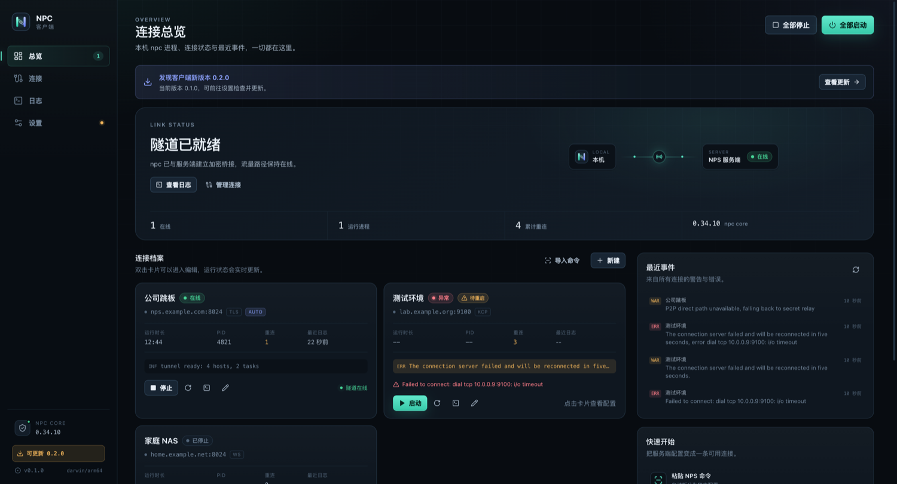
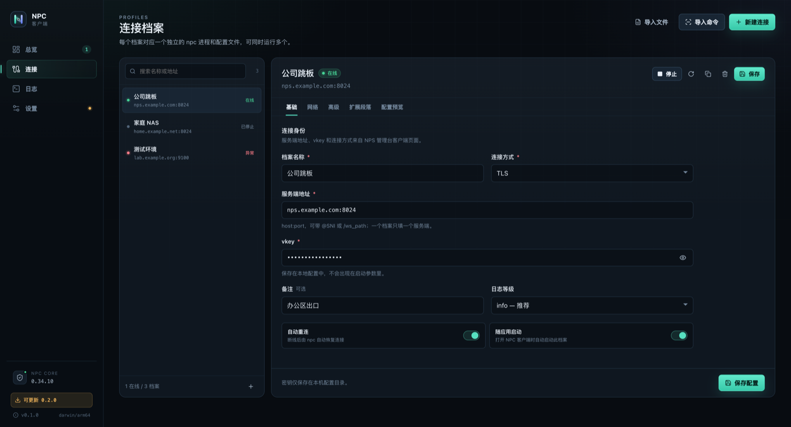
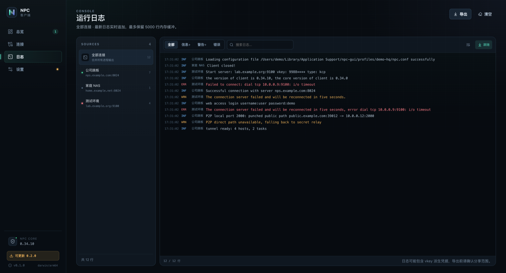

  

# NPC GUI

English | [中文](README.zh.md)

NPC GUI is a desktop client for NPS. It manages [djylb/nps](https://github.com/djylb/nps) npc reverse-tunnel processes and brings configuration, process control, status, logs, and version maintenance into one desktop application.

## Business overview

NPC GUI is built for developers and operators who keep reverse-tunnel connections running for long periods. One application manages multiple NPS server profiles. Each profile owns its configuration, process, state, and logs.

The application provides:

- Connection profiles for TCP/TLS/KCP/QUIC/WS/WSS, proxy, authentication, and reconnect settings.
- Import of NPS launch commands without executing them.
- One isolated npc process per profile.
- Live state, log filtering, search, follow mode, and export.
- npc detection, download, SHA-256 verification, and client updates from GitHub Releases.
- System tray, launch at login, desktop notifications, and close-to-tray behavior.

| Profiles | Logs |
|---|---|
|  |  |

More screenshots are in [docs/screenshots](docs/screenshots).

## Build and run

Development requires Go 1.25.x, Node.js 22.x, pnpm 10.x, and Wails v2.12.0. macOS also requires Xcode Command Line Tools. Windows builds require the WebView2 Runtime and NSIS for installer packaging. Linux builds require GTK3 and WebKit2GTK 4.1.

Install and verify the Wails CLI:

~~~bash
go install github.com/wailsapp/wails/v2/cmd/wails@v2.12.0
wails doctor
~~~

Install frontend dependencies and start the development build:

~~~bash
cd frontend
pnpm install
cd ..
wails dev
~~~

Build a local application:

~~~bash
./scripts/build-local.sh
~~~

The build output includes the macOS application at build/bin/npc-gui.app and platform packages under dist/.

## Releases

Release artifacts are published on GitHub Releases: macOS .app.zip, a Windows NSIS installer, a Windows portable .exe, and Linux .tar.gz. On first launch, the application offers to download npc, select a local npc binary, or detect npc on PATH.

## Contributing

Issues and pull requests are welcome. Changes should keep the documentation consistent with the implementation.

## License

The application code is released under the [MIT License](LICENSE). The npc core uses GPLv3 and is not bundled with this application. Third-party dependencies are listed in [THIRD_PARTY_NOTICES.md](THIRD_PARTY_NOTICES.md).
