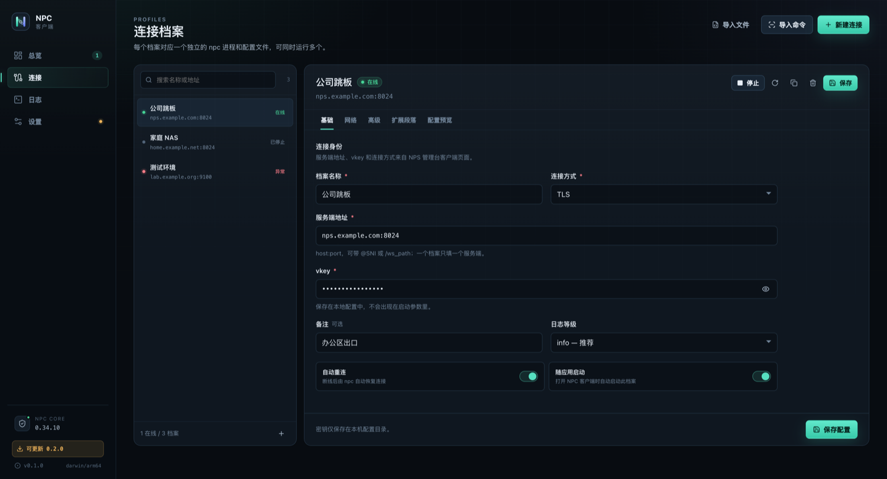
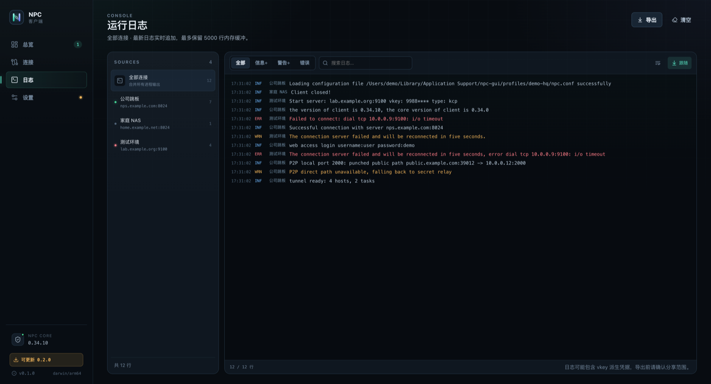

  

# NPC GUI

[English](README.md) | 中文

NPC GUI 是 NPS 的桌面客户端。它用于管理 [djylb/nps](https://github.com/djylb/nps) 的 npc 内网穿透进程，并把配置、进程控制、状态、日志和版本维护整合到同一个桌面应用中。

## 业务概览

NPC GUI 面向需要长期运行内网穿透连接的个人开发者和运维人员。一个应用可以管理多个 NPS 服务端连接，每个连接拥有独立的配置、进程、状态和日志。

应用提供以下能力：

- 连接档案支持 TCP/TLS/KCP/QUIC/WS/WSS、代理、认证和断线重连配置。
- 从 NPS 启动命令导入连接信息，导入过程不执行命令。
- 每个档案运行一个独立 npc 进程。
- 实时状态、日志过滤、搜索、跟随滚动和导出。
- npc 检测、下载、SHA-256 校验，以及客户端 GitHub Releases 更新。
- 系统托盘、开机自启、桌面通知和关闭到托盘。

| 连接档案 | 运行日志 |
|---|---|
|  |  |

更多界面截图位于 [docs/screenshots](docs/screenshots)。

## 构建与运行

开发环境需要 Go 1.25.x、Node.js 22.x、pnpm 10.x 和 Wails v2.12.0。macOS 还需要 Xcode Command Line Tools；Windows 构建需要 WebView2 Runtime；Linux 构建需要 GTK3 和 WebKit2GTK 4.1。

安装并检查 Wails CLI：

~~~bash
go install github.com/wailsapp/wails/v2/cmd/wails@v2.12.0
wails doctor
~~~

安装前端依赖并启动开发构建：

~~~bash
cd frontend
pnpm install
cd ..
wails dev
~~~

构建本地应用：

~~~bash
./scripts/build-local.sh
~~~

构建产物包括 build/bin/npc-gui.app 以及 dist/ 下的平台发布包。

## 发布版本

发布版本由 GitHub Releases 提供，包含 macOS .app.zip、Windows .exe 和 Linux .tar.gz。首次启动时，应用提供下载 npc、选择本地 npc 或检测 PATH 三种方式。

## 参与贡献

欢迎提交 Issue 和 Pull Request。文档修改需要与实现保持一致。

## 许可证

应用代码使用 [MIT License](LICENSE)。npc 核心使用 GPLv3，不随应用分发。第三方依赖见 [THIRD_PARTY_NOTICES.md](THIRD_PARTY_NOTICES.md)。
